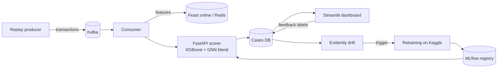

# AIML-01 – Real-Time Financial Fraud Detection Platform

Nexvia Technologies internship capstone, Project #2 of 2. The other project,
**AIML-04 Autonomous Driving Perception Stack**, is on the [`main` branch](../../tree/main).

> Work in progress. Plan and status: [`PLAN.md`](PLAN.md).

A system that reads live transactions, scores each one for fraud risk in milliseconds, links
suspicious accounts into fraud rings, and gives analysts a dashboard to review cases.

## Planned architecture

## Stack
Kafka · XGBoost · PyTorch Geometric · Feast · MLflow · FastAPI · Kubernetes (Minikube) ·
Evidently AI · Streamlit. Dataset: IEEE-CIS Fraud Detection (Kaggle).

Setup, run steps, results and the feature breakdown will be added as milestones finish.
