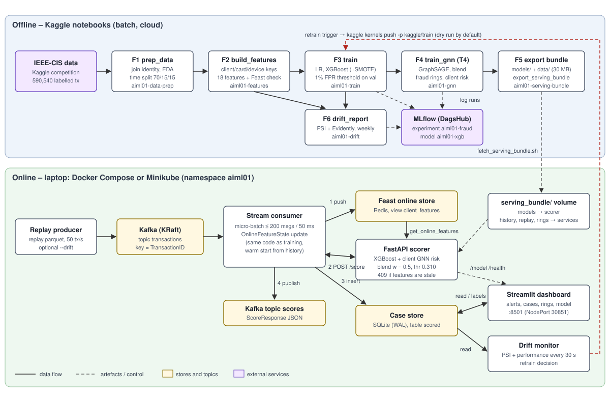
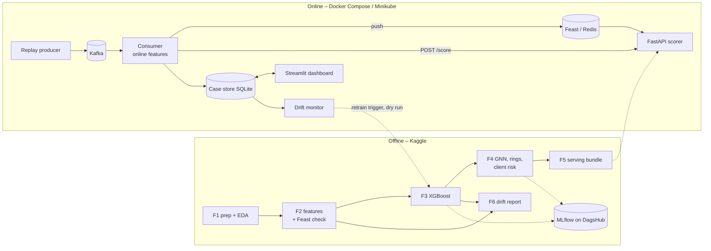
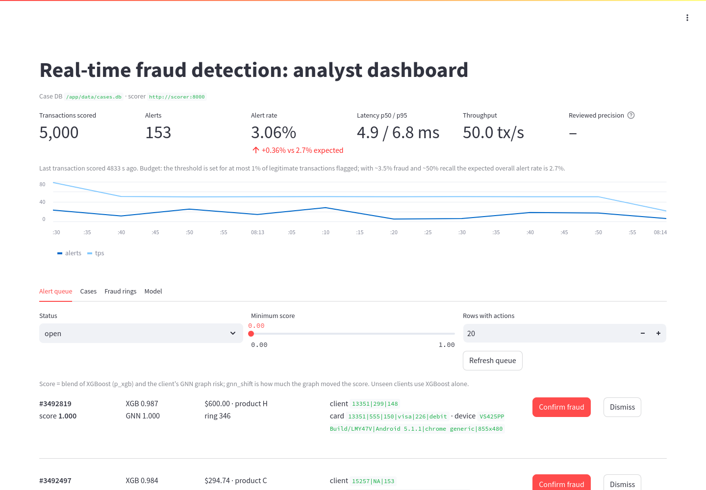
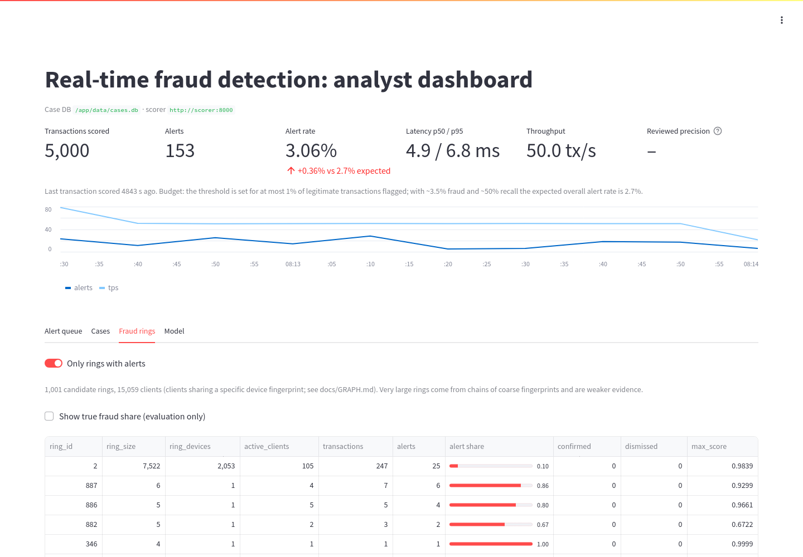
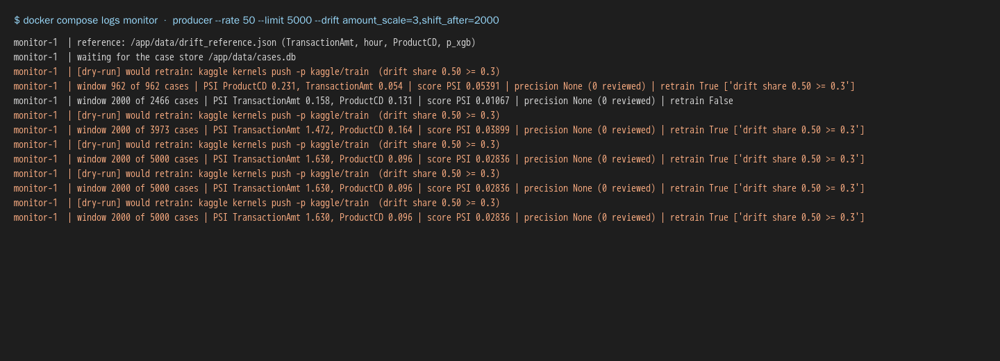

# AIML-01 – Real-Time Financial Fraud Detection Platform

Nexvia Technologies internship capstone (AI/ML track), Project #2 of 2. This project lives on
branch **`AIML-01`** of this repository. The other project, **AIML-04 Autonomous Driving
Perception Stack**, is on branch [`main`](https://github.com/Outsideorbit29/aiml04-perception/tree/main).
The two branches are never merged.

**Live demo:** [aiml01-fraud-dashboard.streamlit.app](https://aiml01-fraud-dashboard.streamlit.app): the analyst dashboard on
Streamlit Community Cloud in demo mode (synthetic data, not IEEE-CIS; entrypoint
`services/dashboard/streamlit_app.py`). The full streaming stack runs locally with Docker Compose or Minikube.

## Overview
The platform reads a stream of card transactions, scores each one for fraud risk in a few
milliseconds, links clients that share device fingerprints into candidate fraud rings, and gives
analysts a dashboard to confirm or dismiss alerts. It uses the IEEE-CIS Fraud Detection data
(590,540 labelled transactions, 3.5% fraud). Training and evaluation run as Kaggle jobs and log to
MLflow; the serving stack (Kafka, Feast on Redis, a FastAPI scorer, a SQLite case store, a
Streamlit dashboard and a drift monitor) runs on a laptop with Docker Compose or Minikube. The
scorer blends an XGBoost model with a per-client risk from a GraphSAGE GNN, and the stream
consumer computes the same behavioural features with the same code used for training.

## Results

All numbers are on the time-ordered **test** split (88,581 transactions), with the alert threshold
chosen on val so that 1% of legit transactions are flagged. Details: [`docs/MODEL.md`](docs/MODEL.md),
[`docs/GRAPH.md`](docs/GRAPH.md), [`docs/SERVING.md`](docs/SERVING.md), [`docs/DRIFT.md`](docs/DRIFT.md).

**Models (F3, F4)**

| Model | Test PR-AUC | Test ROC-AUC | Recall @ 1% FPR budget | Precision | Test FPR |
|---|---:|---:|---:|---:|---:|
| Logistic regression (balanced) | 0.357 | 0.860 | 35.2% | 44.3% | 1.59% |
| XGBoost, raw fields only | 0.463 | 0.874 | 43.5% | 53.6% | 1.36% |
| XGBoost + F2 features (class weights) | 0.457 | 0.869 | 42.6% | 55.8% | 1.22% |
| XGBoost + F2 features + SMOTE | 0.491 | 0.890 | 45.4% | 55.8% | 1.30% |
| GraphSAGE alone | 0.506 | 0.897 | 46.7% | 55.7% | 1.34% |
| Blend, full graph (offline only, w = 0.5) | 0.545 | 0.909 | 50.4% | 58.3% | 1.30% |
| **Live blend: XGBoost + client GNN risk (served)** | **0.525** | 0.905 | **49.8%** | 58.0% | 1.30% |

Fraud rings: 1,001 rings with 15,059 clients; test fraud rate 9.9% inside rings vs 2.5% outside.

**Serving (F5, laptop Docker Desktop, 4 CPUs, 6 GB)**

| Measure | Result |
|---|---|
| Steady 50 tx/s, end-to-end (producer → scored and stored) | p50 83 ms, p95 128 ms, p99 161 ms |
| Scorer HTTP round trip (Feast read + XGBoost + blend) | p50 3.81 ms, p95 5.29 ms, p99 7.88 ms |
| Unthrottled burst | 242 tx/s sustained |
| Live detection, first 5,000 replayed test transactions | 64 of 131 frauds caught (49%), 1.7% false-alert rate |

**Drift (F6, Kaggle `anish2906/aiml01-drift`, 9 weekly windows of val + test vs train)**

| Measure | Result |
|---|---|
| PSI drift share (features with PSI ≥ 0.2) | 0 in every window; max feature PSI 0.19 |
| Evidently drifted share | 0.08–0.22 (preset threshold 0.3) |
| Score PSI | ≤ 0.006 |
| False-alert rate at the fixed threshold | 0.88% (first week) → 1.36% (last week) |
| Weekly PR-AUC | 0.42–0.69 |
| Retrain trigger | did not fire at the configured thresholds (1.5× budget, PR-AUC < 0.40) |

## Architecture



Full description, data flow and design decisions: [`docs/ARCHITECTURE.md`](docs/ARCHITECTURE.md).
API, message and schema reference: [`docs/API.md`](docs/API.md).



## Feature breakdown

| Brief requirement | What was built | Docs |
|---|---|---|
| Dataset + EDA, class imbalance | IEEE-CIS joined with identity; time-ordered 70/15/15 split; EDA on imbalance (3.5%), amounts, product, device, email, time of day, drift over time, missingness | [`docs/EDA.md`](docs/EDA.md) |
| Velocity, amount vs average, device/location change; Feast | Client key `card1 \| addr1 \| day − D1`; 18 point-in-time features (1 h / 24 h / 7 d counts and sums, amount vs client mean, new device / address / email, device sharing); Feast entity `client`, view `client_features`, file offline store, Redis online store; parity 1.6e-11 | [`docs/FEATURES.md`](docs/FEATURES.md) |
| XGBoost with class weights or SMOTE, PR-AUC, MLflow | LR baseline, XGBoost with weights and with SMOTE; PR-AUC, ROC-AUC, recall at a 1% FPR budget; all runs in MLflow on DagsHub; model `aiml01-xgb` registered | [`docs/MODEL.md`](docs/MODEL.md) |
| Graph, PyTorch Geometric GNN, fraud rings, blend | Heterogeneous graph (transaction, client, card, device); 2-layer GraphSAGE on a Kaggle T4; rings from shared specific device fingerprints; logit blend, live-servable through a client risk lookup | [`docs/GRAPH.md`](docs/GRAPH.md) |
| Kafka producer, FastAPI service with feature lookup | Replay producer, micro-batching consumer, FastAPI `/score` reading Feast with a stale-feature guard (409), case store, `scores` topic; load test | [`docs/SERVING.md`](docs/SERVING.md), [`docs/API.md`](docs/API.md) |
| Evidently drift reports, automatic retraining trigger | Weekly PSI + Evidently report on Kaggle; live monitor every 30 s; six retrain checks; trigger launches the Kaggle training job (dry run by default) | [`docs/DRIFT.md`](docs/DRIFT.md) |
| Analyst dashboard; Kubernetes | Streamlit: live overview, alert queue with score breakdown, confirm / dismiss feedback, cases, fraud-ring network, model page. Docker Compose and Minikube manifests (`k8s/`) | [`docs/DASHBOARD.md`](docs/DASHBOARD.md), [`docs/DEPLOY.md`](docs/DEPLOY.md) |

## Repository layout

```
configs/            YAML for every stage (data, features, train, gnn, mlflow, serving, drift)
fraud/              core package, no Kafka/HTTP/Kubernetes: data, eda, features, model, metrics,
                    graph, gnn, scoring, store, cases, drift, dashboard_data, tracking, synthetic
scripts/            stage entry points (prep_data, build_features, feast_check, train, train_gnn,
                    export_serving_bundle, drift_report, drift_retrain, make_fixtures,
                    fetch_serving_bundle.sh)
kaggle/<job>/       Kaggle runners + kernel-metadata.json: data_prep, features, train, gnn,
                    serving_bundle, drift
feature_repo/       Feast definitions and store configs (SQLite dev, Redis serving)
services/           producer, consumer, scorer (FastAPI), monitor, dashboard (Streamlit); Dockerfiles
k8s/                Minikube manifests (namespace aiml01, kustomization)
docker-compose.yml  local serving stack
tests/              pytest suite + synthetic fixtures (300 rows)
docs/               write-ups, architecture, API, test report, figures
.github/workflows/  CI: ruff + pytest
```

## Setup

### Where things run
| Where | What |
|---|---|
| Kaggle notebooks | data prep, EDA, features, training (XGBoost on CPU, GNN on a T4), serving bundle, offline drift report |
| GitHub Actions | `ruff check .` and `pytest -q` on every push |
| MLflow on DagsHub | runs, metrics, registered model (`dagshub.com/Outsideorbit29/aiml04-perception.mlflow`, experiment `aiml01-fraud`) |
| Laptop (Windows 11, Docker Desktop / WSL2) | serving stack only: Kafka, Redis, scorer, consumer, monitor, dashboard; Minikube |

No training or full-dataset job runs on the laptop. The competition data is not in the repo; the
tests use 300 synthetic rows in `tests/fixtures/`.

### Prerequisites
- Kaggle account with the IEEE-CIS Fraud Detection competition rules accepted, and the Kaggle CLI.
  A `pip install --user kaggle` on Windows puts the CLI in
  `%APPDATA%\Python\Python3xx\Scripts\kaggle.exe`, which is usually not on PATH. Scripts read the
  CLI path from the `KAGGLE` environment variable (default `kaggle`).
- MLflow token: Kaggle jobs read the DagsHub token from the private Kaggle dataset
  `anish2906/aiml04-secrets` (file `dagshub_token`); locally from `MLFLOW_TRACKING_PASSWORD`.
  Without a token the jobs log to a file store in the Kaggle output.
- Docker Desktop (Compose v2). For Kubernetes: `minikube` and `kubectl`.
- Python 3.10 for anything run outside containers (system Python 3.14 lacks some wheels, see Tests).

### Windows / Git Bash notes
- Run the shell commands below in **Git Bash** (or WSL) from the repository root, checked out on
  branch `AIML-01`.
- Point `KAGGLE` at the CLI, e.g.
  `export KAGGLE="$APPDATA/Python/Python314/Scripts/kaggle.exe"` (adjust the Python version), and
  call `"$KAGGLE"` instead of `kaggle`.
- Docker Desktop's WSL memory cap (`.wslconfig`, 6 GB here) is shared by Compose and Minikube; stop
  one before starting the other.
- Kaggle jobs clone `--branch AIML-01`, so push the branch before `kaggle kernels push`.

## How to run each stage

### Offline stages (Kaggle; run from the laptop, the work happens in the cloud)
Each `kaggle/<job>/runner.py` clones the branch and runs one script. Set `MODE = "smoke"` in the
runner for a small run first, then `"full"`.

| Stage | Launch (Git Bash) | Script it runs | Inputs attached |
|---|---|---|---|
| F1 data prep + EDA | `"$KAGGLE" kernels push -p kaggle/data_prep` | `python -m scripts.prep_data --config configs/data.yaml` | competition `ieee-fraud-detection` |
| F2 features + Feast check | `"$KAGGLE" kernels push -p kaggle/features` | `python -m scripts.build_features`, then `python -m scripts.feast_check` | `aiml01-data-prep` |
| F3 training | `"$KAGGLE" kernels push -p kaggle/train` | `python -m scripts.train --config configs/train.yaml` | `aiml01-features`, `aiml04-secrets` |
| F4 GNN (T4) | `"$KAGGLE" kernels push -p kaggle/gnn` | `python -m scripts.train_gnn --config configs/gnn.yaml` | `aiml01-features`, `aiml01-train`, `aiml04-secrets` |
| F5 serving bundle | `"$KAGGLE" kernels push -p kaggle/serving_bundle` | `python -m scripts.export_serving_bundle` | `aiml01-data-prep`, `aiml01-train`, `aiml01-gnn` |
| F6 drift report | `"$KAGGLE" kernels push -p kaggle/drift` | `python -m scripts.drift_report --config configs/drift.yaml` | `aiml01-data-prep`, `aiml01-features`, `aiml01-train`, `aiml04-secrets` |

Check a job with `"$KAGGLE" kernels status anish2906/aiml01-<job>`. Each job's outputs are the next
job's inputs. Every run is listed in [`docs/EXPERIMENTS.md`](docs/EXPERIMENTS.md).

### Online stack (laptop, Docker Compose)
```bash
# Git Bash, repo root, Docker Desktop running
bash scripts/fetch_serving_bundle.sh                           # ~30 MB into ./serving_bundle (gitignored)
docker compose up -d --build kafka redis scorer consumer monitor dashboard
docker compose logs -f consumer                                # wait for "consumer ready"
docker compose run --rm producer --rate 50 --limit 5000        # replay test-period transactions
# dashboard: http://localhost:8501   scorer API docs: http://localhost:8000/docs
curl localhost:8000/model                                      # model card
cat serving_bundle/data/consumer_stats.json                    # latency / throughput
docker compose down
```

F6 drift demo on the same stack (details in [`docs/DRIFT.md`](docs/DRIFT.md)):
```bash
docker compose run --rm producer --rate 50 --limit 5000 --drift amount_scale=3,shift_after=2000
docker compose logs -f monitor      # retrain decision and the "[dry-run] would retrain" line
```

Retrain trigger from the laptop (dry run unless `--execute`):
```bash
python -m scripts.drift_retrain --status serving_bundle/data/monitor_status.json
```

### Kubernetes (Minikube)
Step-by-step commands (cluster, image load, bundle copy into the PVC, `kubectl apply -k k8s/`,
producer Job, dashboard on NodePort 30851, teardown) are in [`docs/DEPLOY.md`](docs/DEPLOY.md).

## Tests and CI

- CI (`.github/workflows/ci.yml`, Python 3.10): `ruff check .` and `pytest -q`. Latest run on
  `AIML-01` (commit `f1104e7`): ruff clean, **93 passed, 2 skipped** (streamlit and evidently are
  not installed in CI).
- Locally (CPU, quick): `pip install -r requirements-dev.txt && pytest -q`. With the laptop's
  Python 3.14 (`py -3.14 -m pytest -q`) some tests skip because pyarrow / xgboost are missing:
  83 passed, 11 skipped.
- System-level checks (feature parity, Feast match, load test, drift job) and per-file coverage:
  [`docs/TEST_REPORT.md`](docs/TEST_REPORT.md).

## Screenshots

Captured on 2026-11-27 from the Docker stack after a 5,000-transaction replay with drift injection
(headless Chrome inside the compose network).

**Analyst dashboard** (live overview + alert queue):



**Fraud rings tab:**



**Drift monitor** (`--drift amount_scale=3,shift_after=2000`; dry-run retraining trigger):



More: [scorer OpenAPI docs](docs/screenshots/scorer_docs.png),
[cases tab](docs/screenshots/dashboard_cases.png), [model tab](docs/screenshots/dashboard_model.png).

## Demo video

> **Placeholder.** Demo video link: TBD (3–4 min screen recording, to be uploaded by the user).

## Documentation

| Doc | Content |
|---|---|
| [`docs/PROJECT_BRIEF.md`](docs/PROJECT_BRIEF.md) | the original brief |
| [`PLAN.md`](PLAN.md) | milestones F0–F8 |
| [`docs/ARCHITECTURE.md`](docs/ARCHITECTURE.md) | components, data flow, design decisions |
| [`docs/API.md`](docs/API.md) | scorer API, Kafka messages, case store, Feast, bundle, configs |
| [`docs/EDA.md`](docs/EDA.md), [`docs/FEATURES.md`](docs/FEATURES.md), [`docs/MODEL.md`](docs/MODEL.md), [`docs/GRAPH.md`](docs/GRAPH.md) | data, features, models, graph |
| [`docs/SERVING.md`](docs/SERVING.md), [`docs/DRIFT.md`](docs/DRIFT.md), [`docs/DASHBOARD.md`](docs/DASHBOARD.md), [`docs/DEPLOY.md`](docs/DEPLOY.md) | streaming, drift, dashboard, deployment |
| [`docs/EXPERIMENTS.md`](docs/EXPERIMENTS.md) | every Kaggle job and run |
| [`docs/TEST_REPORT.md`](docs/TEST_REPORT.md) | test results |

## Credits and licences

- Code: [GNU AGPL-3.0](LICENSE), the same licence as the AIML-04 project on `main`.
- Data: [IEEE-CIS Fraud Detection](https://www.kaggle.com/c/ieee-fraud-detection) (Vesta
  Corporation, via Kaggle). It is used under the competition rules and is not redistributed here;
  accept the rules on Kaggle to run the jobs.
- Main libraries: XGBoost, PyTorch Geometric, Feast, MLflow, FastAPI, Apache Kafka
  (confluent-kafka), Redis, Evidently, Streamlit, imbalanced-learn, scikit-learn.
