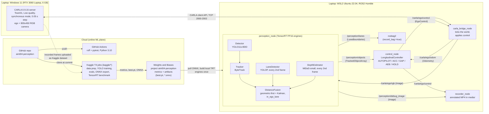

# Autonomous Driving Perception Stack (AIML-04)

[](https://github.com/Outsideorbit29/aiml04-perception/actions/workflows/ci.yml)

A camera-only perception stack built for the Nexvia Technologies AI/ML internship. For each frame
it detects vehicles, pedestrians, cyclists and traffic lights/signs with a YOLO11s model
fine-tuned on BDD100K, tracks them with ByteTrack, finds the ego lane (classical OpenCV and YOLOP,
compared), and estimates each object's distance from flat-ground geometry plus MiDaS-small depth,
with a per-track Kalman filter for closing speed and time to collision. The same ROS-free
`perception/` package runs on dataset videos (Kaggle) and live in the CARLA simulator, where ROS2
nodes feed it camera frames and a rule-based controller brakes for obstacles in the ego lane.
Models are exported to ONNX and run as TensorRT FP16 engines. Training, evaluation and benchmarks
run on Kaggle and are logged to Weights & Biases; the laptop only runs CARLA and ROS2.

## Demo

> **TODO (M7.4):** demo GIF here (`media/demo.gif`, 10–15 s from the `stopped_car` run).
>
> **TODO (M7.4):** link to the 3–4 min demo video (YouTube unlisted or Drive).
>
> **TODO (M7.8, stretch):** live deployment URL (Hugging Face Space running the offline pipeline),
> or the demo video link if the Space is not built.

## Results

Every number below is copied from [docs/EXPERIMENTS.md](docs/EXPERIMENTS.md) or
[docs/benchmarks.md](docs/benchmarks.md); the W&B run id is linked. W&B project:
`anish-grd2004-vellore-institute-of-technology/aiml04-perception`.

| Area | Metric | Result | Baseline / comparison | Data | W&B |
|---|---|---|---|---|---|
| Detection | mAP@0.5 / mAP@0.5:0.95 | **0.553** / 0.309 (YOLO11s fine-tuned, 50 epochs) | COCO zero-shot 0.361 / 0.210 (7 shared classes only); fine-tuned on the same 7 classes 0.560 / 0.321 | BDD100K val, 10k images, 640 px | [6euheeu2](https://wandb.ai/anish-grd2004-vellore-institute-of-technology/aiml04-perception/runs/6euheeu2), eval [8tzih6my](https://wandb.ai/anish-grd2004-vellore-institute-of-technology/aiml04-perception/runs/8tzih6my) |
| Detection, sim | mAP@0.5 / mAP@0.5:0.95 | 0.530 / 0.308 | COCO zero-shot 0.485 / 0.286 | 3,000 recorded CARLA Town01 frames, 6 weathers | [ytp5wgb0](https://wandb.ai/anish-grd2004-vellore-institute-of-technology/aiml04-perception/runs/ytp5wgb0) |
| Tracking | MOTA / IDF1 / ID switches | **52.5 / 67.4 / 176** (ByteTrack, buffer 60, 2 consecutive frames) | ByteTrack default 52.3 / 65.7 / 310. Vehicles 63.7 / 75.7, pedestrians 38.5 / 54.9 | KITTI tracking, 8 sequences, 2,358 frames | [qvrkp7t1](https://wandb.ai/anish-grd2004-vellore-institute-of-technology/aiml04-perception/runs/qvrkp7t1) |
| Lanes | Lane-line F1 | **YOLOP 0.515** | Classical (HLS + Sobel, sliding window) 0.231. Ego-lane IoU is a tie: 0.415 vs 0.423 | BDD100K val, 500 images | [bf4xp164](https://wandb.ai/anish-grd2004-vellore-institute-of-technology/aiml04-perception/runs/bf4xp164) |
| Distance, real | AbsRel (all / 30–60 m), coverage | Fused geometric + MiDaS-small **0.170** / 0.221, coverage 1.00 | Geometric only 0.168 / 0.234, coverage 0.96 | KITTI, 1000 frames vs LiDAR, GT boxes | [amgl803i](https://wandb.ai/anish-grd2004-vellore-institute-of-technology/aiml04-perception/runs/amgl803i) |
| Distance, sim | AbsRel, detected boxes on held-out frames | **0.112** (live config: geometric-first + box-bottom calibration) | 0.140 with the earlier fusion, uncalibrated | CARLA, 1,389 objects on odd frames (calibration fitted on even frames) | [20l3ugzs](https://wandb.ai/anish-grd2004-vellore-institute-of-technology/aiml04-perception/runs/20l3ugzs), [nfekm9vg](https://wandb.ai/anish-grd2004-vellore-institute-of-technology/aiml04-perception/runs/nfekm9vg) |
| TensorRT | Model p50 latency, T4, batch 1 | YOLO11s **3.66 ms**, MiDaS-small **2.58 ms**, YOLOP **6.70 ms** (FP16) | PyTorch FP32 9.93 / 10.95 / 22.78 ms, i.e. 2.72x / 4.25x / 3.40x faster | Kaggle T4, 1000 timed iterations | [218me22j](https://wandb.ai/anish-grd2004-vellore-institute-of-technology/aiml04-perception/runs/218me22j) |
| TensorRT accuracy cost | TRT FP16 vs PyTorch FP32 | YOLO mAP@0.5 −0.0001; MiDaS output AbsRel 0.0096; YOLOP lane-mask IoU 0.9928 | – | 500 BDD val images (YOLO), 100 frames (MiDaS, YOLOP) | [218me22j](https://wandb.ai/anish-grd2004-vellore-institute-of-technology/aiml04-perception/runs/218me22j) |
| Live loop (laptop) | Mean pipeline time with CARLA on the same GPU | **40–45 ms** per frame over 100-frame windows (~22–25 FPS); 4.9 sim steps/s in synchronous mode | Offline TensorRT on 100 recorded CARLA frames without CARLA: 66.8 FPS stage time, 33.8 FPS wall | RTX 3060 Laptop 6 GB, TensorRT FP16 engines | – (local run; [benchmarks.md](docs/benchmarks.md)) |
| Closed loop | `stopped_car` scenario | **Stopped 6.9 m short, no collision** (ACC/GAP slow-downs, then AEB at 8.0 m) | Earlier fusion: 6.5 m gap | CARLA Town01, ClearNoon | – (local run; EXPERIMENTS.md "Closed loop in CARLA") |

How to read these numbers:
- The zero-shot baseline is scored on the 7 classes COCO shares with BDD; compare it with the
  fine-tuned 0.560 on those classes. Fine-tuning gains +0.20 mAP@0.5 on BDD but only +0.045 on
  CARLA frames, so most of the BDD gain does not transfer to rendered images.
- The tracker settings were chosen and scored on the same 8 KITTI sequences (in-sample).
- Lane F1 counts measured boundaries only. YOLOP returns no line on 129 of 500 images (worn
  markings, snow, dense traffic), which is why the ego-lane IoU is a tie.
- KITTI distance is scored on ground-truth boxes, so it measures distance only. KITTI camera
  height and pitch are exact, which favours the geometric method.
- The live loop number is perception stage time averaged over 100 frames. The one-frame overlay
  readings in `docs/benchmarks.md` are not averages and are not quoted here. p95 latency in the
  live loop is not logged yet (**TBD**).
- Only the `stopped_car` scenario has been run in closed loop so far. `pedestrian_crossing`,
  `cut_in` and `night_rain` are scripted in `sim/scenarios/` but have no results yet (**TBD**,
  owner `sim-ros-integrator`, PLAN.md M5.5/M5.8).

Full tables, per-class AP, per-condition lane results, distance bins and caveats are in
[docs/EXPERIMENTS.md](docs/EXPERIMENTS.md), [docs/benchmarks.md](docs/benchmarks.md),
[docs/figures/lanes_comparison.md](docs/figures/lanes_comparison.md) and
[docs/figures/depth_comparison.md](docs/figures/depth_comparison.md).

## Architecture at a glance



- **carla_bridge_node** is the only node that talks to CARLA. It runs the world in synchronous
  mode and ticks it only after the control for the previous frame arrives (or a timeout), so
  perception latency never desyncs the simulation.
- **perception_node** wraps `perception.pipeline.Pipeline` (detect, track, lanes, depth,
  fusion) on TensorRT engines. No PyTorch is installed on the laptop.
- **control_node** wraps `perception.control.LongitudinalController`. The CARLA Traffic Manager
  steers; the controller overrides throttle/brake when a lead object has been in the ego lane
  for several frames: emergency braking (AEB) on low time to collision or short distance, then
  a hold at standstill, and proportional slow-downs (ACC, GAP) before that. Thresholds are in
  `control` of `configs/carla.yaml`.

More: the pipeline data-flow diagram in [docs/diagrams/](docs/diagrams/README.md), the design in
[ARCHITECTURE.md](ARCHITECTURE.md), and topics, messages and Python interfaces in
[docs/API.md](docs/API.md).

## Where things run (cloud-first)

The laptop load is kept low on purpose: anything that can run online runs online.

| Where | What runs there |
|---|---|
| Kaggle notebooks (T4) | Dataset prep and EDA, YOLO training, every dataset evaluation, ONNX export, T4 TensorRT benchmark, offline pipeline videos, sim eval on recorded CARLA frames |
| GitHub Actions | `ruff check .` and `pytest -q` on every push (Python 3.10, CPU) |
| Weights & Biases | Metrics of every run; model artifacts (`yolo11s-bdd-best`, `*-onnx`) |
| Laptop, Windows 11 | CARLA 0.9.15 server (sessions of 30 minutes or less), `kaggle` and `wandb` CLIs |
| Laptop, WSL2 Ubuntu 22.04 | ROS2 Humble nodes, live inference on TensorRT, one-time local engine build, demo recording |

The laptop never holds the datasets and never trains. TensorRT engines are tied to the GPU they
were built on, so the laptop pulls the ONNX files from W&B and builds its own engines once.

## Setup

Full steps (accounts, Kaggle token, W&B key for jobs, CARLA, WSL2, ROS2, engine build):
[docs/SETUP.md](docs/SETUP.md). Short version:

1. Accounts: GitHub, Kaggle (phone verified, API token), W&B project `aiml04-perception`.
2. Windows: `pip install kaggle wandb`. No PyTorch or CUDA install is needed on Windows.
3. CARLA 0.9.15 base package extracted to `D:\CARLA_0.9.15`.
4. WSL2 Ubuntu 22.04 with `networkingMode=mirrored`, then
   `wsl -d Ubuntu-22.04 -u root -- bash /mnt/d/Project_ai/sim/setup_wsl.sh` (ROS2 Humble
   ros-base, Cyclone DDS, CARLA client, runtime packages).
5. Pull the ONNX artifacts from W&B into `models/` and build the engines once (see Usage).

## Usage

Each command says where it runs.

**Cloud jobs (launched from the laptop, run on Kaggle).** Push first; the job clones the repo.
```bash
# Windows or WSL2: launch and watch a Kaggle job
git push
kaggle kernels push -p kaggle/train_yolo
kaggle kernels status anish2906/aiml04-train-yolo
kaggle kernels output anish2906/aiml04-train-yolo -p runs/train_yolo   # only if outputs are needed locally
```
| Job folder | What it runs on Kaggle |
|---|---|
| `kaggle/data_prep` | BDD100K to YOLO format (20k train subset + 10k val), EDA, fixtures |
| `kaggle/train_yolo` | `python scripts/train_yolo.py --config configs/yolo_bdd.yaml` |
| `kaggle/eval_track`, `kaggle/eval_mot` | Detection eval, tracking videos, MOT metrics on KITTI |
| `kaggle/eval_lanes`, `kaggle/eval_depth` | Lane comparison on BDD val, distance vs KITTI LiDAR |
| `kaggle/run_pipeline` | Full offline pipeline on a KITTI sequence (annotated MP4 + JSONL) |
| `kaggle/export_bench` | `deploy/export.py`, `deploy/build_local_engine.py`, `deploy/benchmark.py` with `configs/bench.yaml` |
| `kaggle/sim_eval` | `python -m sim.eval_frames --config configs/carla_eval.yaml` on recorded CARLA frames |

**Offline pipeline on a video or image folder (Kaggle, or any machine with the models).**
```bash
# Kaggle (torch backend). On the laptop use --backend tensorrt with engines in models/.
python -m perception.pipeline --source <clip.mp4 or image dir> --out out.mp4 \
    --json frames.jsonl --summary summary.json --snapshots snaps --backend torch --camera kitti \
    --detector-weights <best.pt> --yolop-weights <yolop-640-640.onnx>
```

**Models for the laptop (one time).**
```powershell
# Windows PowerShell, repo root, wandb logged in: download the ONNX artifacts into models/
$p = "anish-grd2004-vellore-institute-of-technology/aiml04-perception"
foreach ($a in "yolo11s-bdd-onnx:v0","midas-small-onnx:v0","yolop-onnx:v0") { python -m wandb artifact get "$p/$a" --root models }
```
```bash
# WSL2, with CARLA stopped (building while CARLA runs is ~4x slower and runs the GPU hot)
python3 deploy/build_local_engine.py --onnx models/*.onnx --fp16
```

**Closed loop in CARLA (laptop, short sessions).**
```powershell
# Windows: start the CARLA server
D:\CARLA_0.9.15\CarlaUE4.exe -quality-level=Low -RenderOffScreen -fps=20
```
```bash
# WSL2: build the ROS2 packages once, then launch the stack
bash /mnt/d/Project_ai/ros2_ws/build_wsl.sh
source /opt/ros/humble/setup.bash && source ~/aiml04_ws/install/setup.bash
export AIML04_REPO_ROOT=/mnt/d/Project_ai RMW_IMPLEMENTATION=rmw_cyclonedds_cpp ROS_LOCALHOST_ONLY=1
ros2 launch perception_ros stack.launch.py carla_host:=localhost town:=Town01 load_town:=true \
    scenario:=stopped_car          # stopped_car | pedestrian_crossing | cut_in | night_rain
```
The recorder writes an annotated MP4 to `media/`, and scenario results are appended to
`runs/scenarios/results.jsonl`. Add `record_bag:=true` for a rosbag2 recording.

**Tests (GitHub Actions on every push; optional locally on CPU).**
```bash
# Optional CPU-only Python 3.10 venv (no torch)
pip install -r requirements-dev.txt
ruff check . && pytest -q
```

## Repository layout

```
├─ perception/              ROS-free, CARLA-free core library
│  ├─ types.py              data contracts (Detection, Track, LaneResult, ObjectState, PerceptionFrame)
│  ├─ pipeline.py           Pipeline + offline CLI (python -m perception.pipeline)
│  ├─ control.py            LongitudinalController (AEB / ACC / GAP / HOLD rules)
│  ├─ detection/            Detector (torch / onnx / tensorrt backends)
│  ├─ tracking/             Tracker (ByteTrack via supervision)
│  ├─ lanes/                classical OpenCV and YOLOP lane detectors
│  ├─ depth/                DepthEstimator (MiDaS), CameraModel, scale alignment, calibration
│  └─ fusion/               DistanceFusion, per-track Kalman filter, ego-lane test
├─ ros2_ws/src/
│  ├─ perception_msgs/      TrackedObject, TrackedObjectArray, LaneBoundaries, EgoControl
│  └─ perception_ros/       bridge, perception, control and recorder nodes + stack.launch.py
├─ sim/                     CARLA helpers, scenarios/, frame recorder, sim eval
├─ deploy/                  ONNX export, TensorRT engine build, benchmark
├─ scripts/                 training and evaluation scripts, data/ (BDD conversion, EDA)
├─ kaggle/                  one folder per cloud job (kernel-metadata.json + runner.py)
├─ configs/                 every tunable: models, thresholds, camera, CARLA, benchmark
├─ tests/                   pytest suite + small fixtures (5 BDD images, 3 s KITTI clip)
├─ docs/                    setup, experiments, benchmarks, API, diagrams, figures, submission
└─ ARCHITECTURE.md  PLAN.md  AGENTS.md  CLAUDE.md
```
Not in git: `data/`, `models/` (ONNX and engines), `runs/`, `media/` (videos), `wandb/`.

## Documentation

| Document | Contents |
|---|---|
| [ARCHITECTURE.md](ARCHITECTURE.md) | Design, components, data contracts, risks |
| [docs/API.md](docs/API.md) | ROS2 topics and messages, Python interfaces, config files |
| [docs/diagrams/](docs/diagrams/README.md) | Architecture and pipeline diagrams (Mermaid) |
| [docs/SETUP.md](docs/SETUP.md) | Environment setup (Kaggle, W&B, CARLA, WSL2, ROS2) |
| [docs/EXPERIMENTS.md](docs/EXPERIMENTS.md) | Every training, evaluation and closed-loop run, decisions log |
| [docs/benchmarks.md](docs/benchmarks.md) | PyTorch vs ONNX Runtime vs TensorRT, laptop end-to-end |
| [PLAN.md](PLAN.md) | Milestones and checklist |
| [docs/SUBMISSION.md](docs/SUBMISSION.md) | Deliverables checklist for the portal |

## Datasets and licences

| Data | Used for | Licence / terms |
|---|---|---|
| [BDD100K](https://bdd-data.berkeley.edu/) (Kaggle mirror `awsaf49/bdd100k-dataset`, weather/time labels from `solesensei/solesensei_bdd100k`) | Detection training (20k subset), detection and lane evaluation | BDD100K licence: non-commercial research use only. The CC0 label on the Kaggle mirror is not the real licence. |
| [KITTI](https://www.cvlibs.net/datasets/kitti/) 3D object (`garymk/kitti-3d-object-detection-dataset`) and tracking (`leducnhuan/kitti-tracking`) | Distance evaluation vs LiDAR, MOT evaluation, test fixture clip | CC BY-NC-SA 3.0 (attribution, non-commercial, share-alike) |
| CARLA synthetic frames (3,000 Town01 frames recorded with `sim/record_dataset.py`, private Kaggle dataset) | Sim-to-real detection and distance evaluation | Rendered by the CARLA simulator; CARLA's code is MIT-licensed and its assets CC-BY |

Datasets are not stored in this repo or on the laptop; only `tests/fixtures/` (a few frames) is
committed. The Drive folder will hold a small sample and the download scripts, not the full data.

## Credits

- Ultralytics YOLO11 (detection training and the PyTorch reference backend).
- `supervision` (ByteTrack implementation).
- YOLOP, hustvl (pretrained lane-line segmentation; release ONNX file `yolop-640-640.onnx`).
- MiDaS, Intel ISL (MiDaS-small and DPT-Hybrid monocular depth).
- CARLA 0.9.15, ROS2 Humble, ONNX Runtime, NVIDIA TensorRT, OpenCV, Weights & Biases, Kaggle.

Check each upstream project's licence before reusing this code outside a research or
educational setting (Ultralytics is AGPL-3.0). This repository has no LICENSE file yet (**TBD**,
owner: main session).

## Limitations

- **Closed loop is tested on one scenario.** Only `stopped_car` has run (stopped 6.9 m short).
  Pedestrian crossing, cut-in and night/rain are scripted but not yet run.
- **Sim-to-real gap.** On CARLA frames, motorcycle AP50 is 0.104 (BDD 0.383) and car AP50 drops to
  0.52 at night and 0.41 in heavy rain (BDD night costs only ~0.03 mAP@0.5). A BDD + CARLA
  fine-tune (M5.9) is in progress; no result yet.
- **Distance reads slightly long on detected boxes in CARLA.** After calibration the held-out bias
  is +0.046 overall; between 0 and 10 m it is +0.25, from cars alongside the ego whose nearest
  point no box bottom shows. On unseen route segments expect a few percent long.
- **Long-range false leads.** On KITTI sequence 0001, 47 of 111 lead frames were objects at least
  2.2 m to the side at more than ~24 m, where the lane mask decides. The controller's lead
  persistence rule filters one-frame cases; tightening the long-range corridor is still open.
- **Lanes.** YOLOP misses lines on worn markings, snow (F1 0.37) and in dense traffic; curves
  are weak for both methods (20 curve images). CARLA lane settings are best-effort, not tuned.
- **Pedestrian tracking is weaker** than vehicle tracking (MOTA 38.5 vs 63.7), partly because
  KITTI cyclist boxes include the bike and BDD rider boxes do not.
- **Live loop runs slower than real time.** Synchronous mode waits for perception and control,
  giving 4.9 sim steps/s with CARLA and the models on the same 6 GB GPU. Videos play at sim speed.
- **Runtime is TensorRT only on the laptop.** ONNX Runtime's CUDA provider does not load in WSL2
  here, so ONNX Runtime falls back to the CPU.

## Next steps

- Run and record the remaining scenarios (M5.5, M5.8) and edit the demo video (M7.4).
- Finish the BDD + CARLA fine-tune (M5.9) and re-run the sim eval.
- Tighten the ego corridor beyond ~24 m and log p95 latency in the live loop.
- Stretch goals not done: DeepSORT comparison (M2.7), YOLO-seg lane model (M3.5), INT8 (M6.6),
  Hugging Face Space (M7.8).
