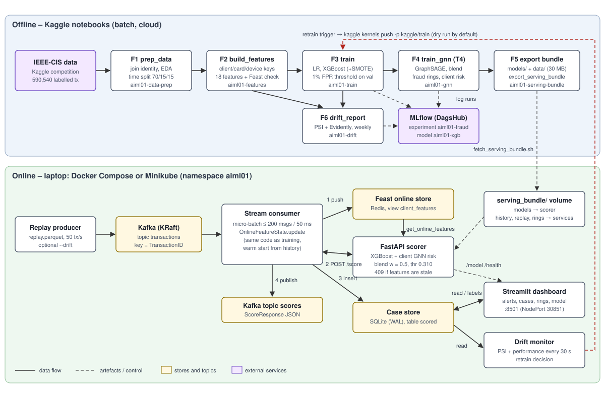
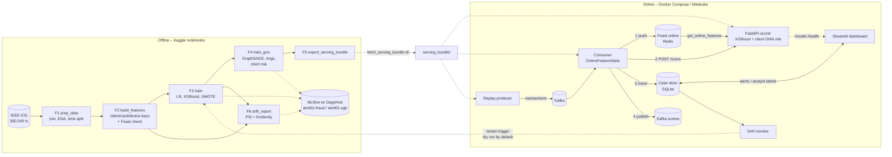

# Architecture – AIML-01 Real-Time Fraud Detection

The system has two halves that share one feature definition and one set of model artefacts:

- **Offline (Kaggle):** batch jobs that prepare the data, build features, train XGBoost and the
  GNN, export a serving bundle and run the weekly drift report. Runs and models go to MLflow.
- **Online (laptop, Docker Compose or Minikube):** a replay producer streams transactions through
  Kafka to a consumer that computes features, pushes them to Feast (Redis), asks the FastAPI scorer
  for a score, and writes the result to a SQLite case store. Analysts work in a Streamlit
  dashboard; a drift monitor watches the case store and can trigger retraining on Kaggle.

Standalone diagram: [`figures/architecture.svg`](figures/architecture.svg). The same flow in Mermaid:

## Components

| Component | Code | Runs on | Role |
|---|---|---|---|
| Data prep + EDA (F1) | `scripts/prep_data.py`, `fraud/data.py`, `fraud/eda.py` | Kaggle `anish2906/aiml01-data-prep` | Join transaction + identity tables, time-ordered 70/15/15 split, EDA figures |
| Features (F2) | `fraud/features.py`, `scripts/build_features.py`, `scripts/feast_check.py`, `feature_repo/` | Kaggle `anish2906/aiml01-features` | Client / card / device keys and 18 behavioural features; Feast offline/online check |
| Classifier (F3) | `fraud/model.py`, `fraud/metrics.py`, `scripts/train.py` | Kaggle `anish2906/aiml01-train` | Logistic regression and XGBoost (class weights, SMOTE); threshold for a 1% FPR budget; MLflow registry |
| Graph + GNN (F4) | `fraud/graph.py`, `fraud/gnn.py`, `scripts/train_gnn.py` | Kaggle `anish2906/aiml01-gnn` (T4) | Heterogeneous graph, GraphSAGE, blend, fraud rings, per-client GNN risk |
| Serving bundle (F5) | `scripts/export_serving_bundle.py`, `scripts/fetch_serving_bundle.sh` | Kaggle `anish2906/aiml01-serving-bundle`, then laptop download | One folder with the model, blend, client risk, history, replay and rings |
| Replay producer | `services/producer/main.py` | container | Streams test-period transactions to Kafka at a fixed rate; optional drift injection |
| Stream consumer | `services/consumer/main.py` | container (one replica) | Features → Feast push → scorer → case store → `scores` topic |
| Scorer | `services/scorer/app.py`, `fraud/scoring.py`, `fraud/store.py` | container | FastAPI `/score`, `/model`, `/health` |
| Case store | `fraud/cases.py` | SQLite file on the bundle volume | Every score; alert status and analyst feedback |
| Dashboard (F7) | `services/dashboard/app.py`, `fraud/dashboard_data.py` | container | Alerts, cases, fraud rings, model info, feedback buttons |
| Drift (F6) | `fraud/drift.py`, `scripts/drift_report.py`, `services/monitor/`, `scripts/drift_retrain.py` | Kaggle `anish2906/aiml01-drift` (offline), container (live) | PSI / Evidently drift, performance checks, retrain decision and trigger |
| Tracking | `fraud/tracking.py`, `configs/mlflow.yaml` | Kaggle jobs | MLflow on DagsHub, experiment `aiml01-fraud`, model `aiml01-xgb` |
| Deployment | `docker-compose.yml`, `services/Dockerfile`, `services/dashboard/Dockerfile`, `k8s/` | laptop | Compose for development, Minikube manifests (namespace `aiml01`) |

The `fraud/` package has no Kafka, HTTP or Kubernetes code, so it is unit-tested on small
fixtures. `services/` holds thin wrappers around it.

## Data flow

### Offline (Kaggle)
1. **F1 prep** reads the IEEE-CIS competition files, joins identity, adds time columns, and splits
   by `TransactionDT` into train / val / test = 413,378 / 88,581 / 88,581 rows (`docs/EDA.md`).
2. **F2 features** computes the keys and features with `build_features` (vectorised pandas) and
   checks them against `OnlineFeatureState` (one transaction at a time) and against Feast
   (`docs/FEATURES.md`). Output: `features/{train,val,test}.parquet` and the Feast offline source
   `client_features.parquet`.
3. **F3 train** fits the four experiments in `configs/train.yaml`, picks the threshold on val
   for 1% of legit transactions flagged, logs everything to MLflow and registers the best model
   as `aiml01-xgb` (`docs/MODEL.md`).
4. **F4 GNN** builds the transaction / client / card / device graph, trains GraphSAGE, finds
   fraud rings, chooses the blend weight on val, and writes `client_risk.parquet`: each client's
   mean GNN probability over earlier periods only (`docs/GRAPH.md`).
5. **F5 bundle** collects what serving needs into `serving_bundle/{models,data}` (30 MB).
6. **F6 drift report** compares weekly windows of val + test with train (PSI, Evidently, score
   PSI, performance) and writes `drift_reference.json` for the live monitor (`docs/DRIFT.md`).

### Online (per transaction)
1. The **producer** reads `replay.parquet` (test period) in time order and publishes each row as
   JSON to Kafka topic `transactions`, keyed by `TransactionID`, with `_produced_at`.
2. The **consumer** polls up to 200 messages (waiting at most 50 ms). For each message it runs
   `OnlineFeatureState.update(tx)`, the same feature code as training, warm-started from
   `history.parquet` (train + val).
3. It pushes the batch's features to Feast (`client_features_push` → Redis), each row tagged with
   its `TransactionID`. A client that repeats inside a batch forces a flush first, because the
   online store holds one row per client.
4. It calls `POST /score` for each transaction. The scorer reads the client's features from Feast,
   returns **409** if they belong to a different transaction, and otherwise computes the XGBoost
   probability and blends it with the client's GNN risk.
5. The consumer writes all results to the **case store** in one SQLite transaction (alerts start
   as `open`) and publishes them to topic `scores`.
6. The **dashboard** reads the case store; analysts confirm or dismiss alerts, which writes the
   feedback label. The **monitor** reads the latest 2,000 scored rows every 30 s, computes drift
   and performance checks, and calls the retrain trigger if a check fires.

## Configuration

| File | Used by | Holds |
|---|---|---|
| `configs/data.yaml` | F1 | input/output dirs, split fractions, `start_date` anchor, smoke rows |
| `configs/features.yaml` | F2, consumer, scorer | key columns, velocity windows, passthrough fields, parity rows |
| `configs/train.yaml` | F3 | experiments, XGBoost / SMOTE / LR parameters, `max_fpr: 0.01`, register name |
| `configs/gnn.yaml` | F4 | GNN size and training, ring rules, blend grid |
| `configs/mlflow.yaml` | all Kaggle jobs | DagsHub tracking URI, experiment, token file, fallback store |
| `configs/serving.yaml` | producer, consumer, scorer, dashboard | Kafka, topics, paths, rates, batch size, timeouts (env overrides) |
| `configs/drift.yaml` | F6 report, monitor, trigger | PSI bins, retrain thresholds, excluded columns, monitor and trigger settings |
| `services/dashboard/dashboard.yaml` | dashboard | rings path, alert budget, refresh, window sizes |
| `feature_repo/feature_store.yaml` / `feature_store.redis.yaml` | Feast | SQLite online store (development) / Redis online store (Compose, Minikube) |
| `k8s/configmap.yaml` | Minikube | env overrides for `configs/serving.yaml` |

Every key in `configs/serving.yaml` (and the dashboard and monitor sections) can be overridden by
an upper-case environment variable, so Compose and Kubernetes use the same files.
Field-level reference: [`docs/API.md`](API.md#configuration-reference).

## Design decisions and trade-offs

**Point-in-time features.** Every feature for a transaction uses only that client's (or card's, or
device's) earlier transactions, in `TransactionDT` order. That makes the training features
computable live without leakage. The batch builder and the streaming state are two implementations
of the same definitions, so parity is tested: max relative difference 1.6e-11 on 30,000 real
transactions with keys 100% equal, and Feast point-in-time reads matched the builder on 5,000
sampled transactions (100%) (`docs/FEATURES.md`). Cost: two code paths to keep in sync; the
tests guard them.

**Client key instead of card key.** IEEE-CIS has no customer ID. The first version keyed on the
card fields and `DeviceInfo`, which turned out to be product and OS labels (about 800 transactions
per "card"), and single-feature separation stayed near chance. The key
`card1 | addr1 | day − D1` gives 217,850 clients and made the velocity features useful
(`cnt_7d` AUC 0.644, `secs_since_prev` 0.330). Trade-off: it is still a heuristic identity, and
40% of transactions are a client's first, so their history features are NaN.

**Live-servable blend.** The full-graph GNN blend gives the best offline test PR-AUC (0.545) but is
transductive: test transactions sit in the graph during training. Running the GNN per
transaction would also be too slow for the live path. The scorer therefore uses a per-client GNN
risk computed from earlier periods only, looked up from a table in memory, blended in logit space
with XGBoost at w = 0.5. That gives test PR-AUC 0.525 (vs 0.491 for XGBoost alone) and recall
49.8% vs 45.4% at the same alert budget. Unseen clients get the XGBoost score alone. Trade-off:
the risk table is only as fresh as the last GNN run, and device and card risk are not used yet.

**Feature freshness check (409).** The consumer pushes features before it calls the scorer, and the
scorer refuses to score when the features in Feast carry another `TransactionID`. That rules out
scoring with stale features. Because the consumer pushes before it scores, the 409 should not
happen in normal operation; if it does, the consumer logs the response and skips that transaction
(there is no retry).

**Micro-batching in the consumer.** A one-by-one consumer topped out at about 43 tx/s on the
laptop (~23 ms per transaction, most of it the Feast push and the SQLite commit). Batching the
Feast push and the case-store commit per poll (≤ 200 messages, ≤ 50 ms wait) keeps up with
50 tx/s at end-to-end p95 128 ms and sustains 242 tx/s unthrottled (`docs/SERVING.md`). Each
transaction is still scored by its own `/score` call. Trade-off: up to 50 ms of added latency,
and a repeated client inside a batch forces an early flush.

**SQLite case store, one consumer.** SQLite in WAL mode is enough for one writer (the consumer) plus
the dashboard's analyst updates. It keeps the stack small enough for a 6 GB laptop. Scaling
consumers horizontally would need Postgres.

**Dry-run retraining.** The monitor and `scripts/drift_retrain.py` decide when to retrain and print
the exact `kaggle kernels push -p kaggle/train` command, at most once per 24 h. They only launch it
with `--execute` or `execute_retrain: true`. This keeps a demo or a noisy window from spending
Kaggle GPU quota, and the IEEE-CIS data has no newer period to retrain on anyway. Offline,
no window crossed the configured thresholds; the false-alert rate rose from 0.88% to 1.36%
against a trigger at 1.5% (`docs/DRIFT.md`).

**Cloud-first.** Training and evaluation run on Kaggle and log to MLflow on DagsHub; the laptop
runs only the serving stack in short sessions. The serving image has no PyTorch: the GNN is used
through the precomputed risk table.
