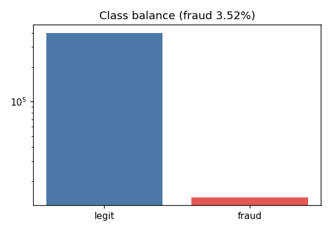
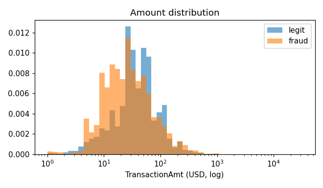
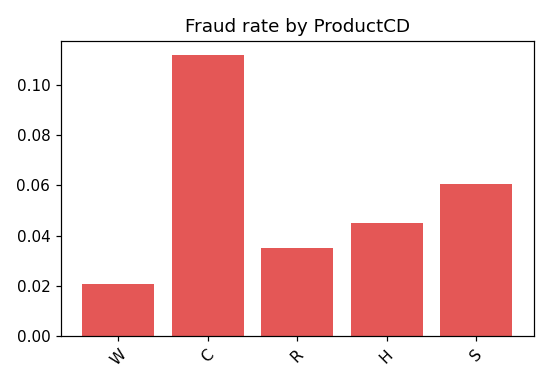
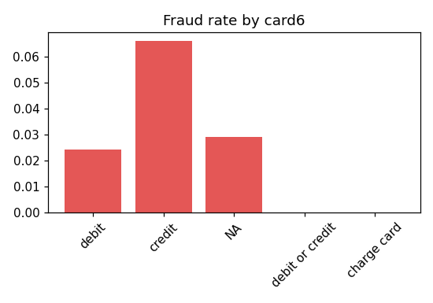
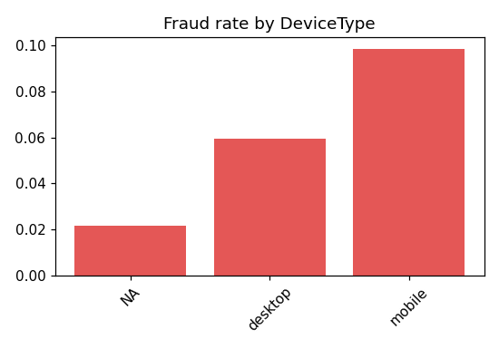
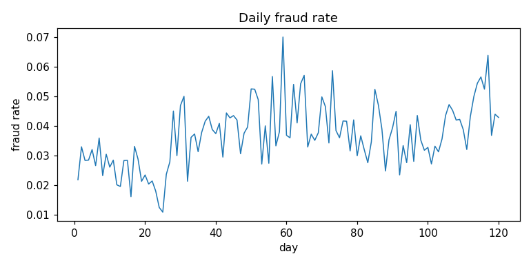
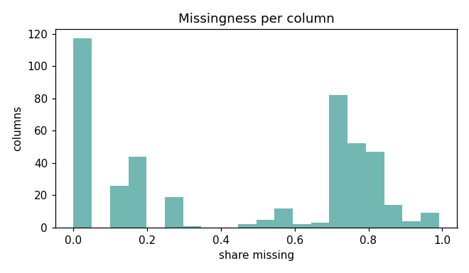

# EDA – IEEE-CIS Fraud Detection (F1)

Kaggle job `anish2906/aiml01-data-prep` v2 (full mode), 2026-11-27. Code: `scripts/prep_data.py`,
`fraud/eda.py`. Numbers below are on the **training split only** so they don't leak into later
modelling choices; split sizes use all labelled data.

## Data and split
- 590,540 labelled transactions × 439 columns after joining identity (+ `has_identity`, time columns).
- Time-ordered 70 / 15 / 15 split over 182 days of `TransactionDT`:

| Split | Rows | Frauds | Fraud rate |
|---|---:|---:|---:|
| train | 413,378 | 14,538 | 3.52% |
| val | 88,581 | 3,042 | 3.43% |
| test | 88,581 | 3,083 | 3.48% |

## Findings
1. **Imbalance: 3.5% fraud.** That's about 28 legit transactions per fraud. The brief says "under 1%",
   which fits PaySim and the ULB card data but not IEEE-CIS. Either way accuracy is useless (97% by
   predicting "legit"), so models are judged by PR-AUC and recall at a fixed false-positive rate.
   
2. **Small amounts are riskier.** Median amount is $75 for fraud vs $69 for legit, but fraud is
   heavily over-represented between $5 and $25, a typical card-testing pattern. Supports the
   "amount vs the card's usual amount" feature.
   
3. **Product and card type matter.** ProductCD `C` has 11.2% fraud vs 2.1% for `W`; credit cards
   6.6% vs debit 2.4%; Discover 6.6% vs Visa 3.5%.
    
4. **Device and identity.** Only 27% of transactions have identity data. Among those, mobile has
   9.9% fraud and desktop 5.9%, against 2.1% for transactions without identity, so "has identity" and
   device type are signals in their own right. Device changes per card are an F2 feature.
   
5. **Email domain.** hotmail.com 5.3% and gmail.com 4.4% vs yahoo.com 2.4% and anonymous.com 2.4%.
6. **Time of day.** Fraud rate peaks at 10% around hour 8 (shifted clock; `TransactionDT` has no
   timezone) and bottoms at 2.2% around hour 13, when most legit traffic happens.
7. **Drift over time.** The daily fraud rate moves between ~1% and ~7% and steps up from ~2.5% to
   ~4% after day 25. A time-based split is therefore required, and this natural shift is useful
   for the F6 Evidently drift demo.
   
8. **Missingness.** 229 of 439 columns are more than 50% missing (mostly `id_*` and many `V*`
   columns). XGBoost handles NaNs natively, so no imputation for the tree model; the GNN only uses
   the dense keys (card, address, email, device).
   

## Decisions for F2/F3
- Entity for velocity features: card key `card1 + addr1 + P_emaildomain` (a refined "user id"
  using `D1` is tried in F2).
- Features: per-card counts/sums over 1 h / 24 h / 7 d, amount ÷ card mean, new device, new
  address, ProductCD, card type, email domain, has_identity, hour.
- Imbalance: XGBoost `scale_pos_weight ≈ 27`, SMOTE as a comparison; metric PR-AUC.
