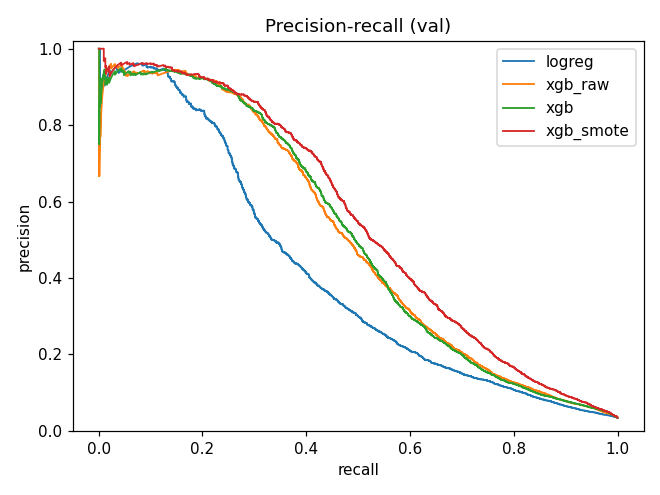

# Fraud model (F3)

Code: `scripts/train.py`, `fraud/model.py`, `fraud/metrics.py`. Config: `configs/train.yaml`.
Kaggle job `anish2906/aiml01-train` v3 (full), 2026-11-27, commit `ab63519`. All runs are in
MLflow on DagsHub (`dagshub.com/Outsideorbit29/aiml04-perception.mlflow`, experiment
`aiml01-fraud`); the serving model is registered as **`aiml01-xgb`**.

## Setup
- Train / val / test = 413,378 / 88,581 / 88,581 transactions, split by time (`docs/EDA.md`).
  Early stopping and model selection use **val**; **test** is reported once.
- Inputs: 20 raw numeric fields (amount, C/D counts and time deltas, hour, …), 8 categoricals
  (ProductCD, card type, email domains, device type, M4/M6) and the 18 F2 behavioural features.
- Metric: **PR-AUC** (average precision). Accuracy is meaningless at 3.5% fraud.
- Operating point: an **alert budget of 1% of legit transactions**. The threshold is set on val
  so 1% of legit val transactions are flagged; recall and precision are reported at that threshold.

## Results

| Model | Val PR-AUC | Test PR-AUC | Test ROC-AUC | Test recall @ 1% FPR | Test precision | Test FPR |
|---|---:|---:|---:|---:|---:|---:|
| Logistic regression (balanced) | 0.410 | 0.357 | 0.860 | 35.2% | 44.3% | 1.59% |
| XGBoost, raw fields only | 0.503 | 0.463 | 0.874 | 43.5% | 53.6% | 1.36% |
| XGBoost + F2 features (class weights) | 0.505 | 0.457 | 0.869 | 42.6% | 55.8% | 1.22% |
| **XGBoost + F2 features + SMOTE** | **0.545** | **0.491** | **0.890** | **45.4%** | **55.8%** | 1.30% |

**Serving model:** XGBoost + SMOTE, 1,127 trees, threshold 0.215. On test it catches 45% of
fraud while flagging about 1.3% of legit traffic; a bit more than half of the alerts are real fraud.

## Findings
1. **XGBoost beats logistic regression by 0.10–0.13 PR-AUC.** Interactions between card type,
   product and the count fields matter more than any single linear effect.
2. **The F2 behavioural features add little on top of the raw fields** (0.505 vs 0.503 on val,
   0.457 vs 0.463 on test). The dataset's anonymised `C*` columns are already per-card counts and the
   `D*` columns time deltas, so most velocity information is present before F2. `cnt_7d` is still
   among the top features of the SMOTE model, and F2 is what makes the features computable live
   from the stream (the raw C/D fields come pre-computed by the data provider).
3. **SMOTE gives the best model** (+0.04 PR-AUC on both val and test). It also fills missing values
   with training medians before resampling, so part of the gain may come from that imputation
   rather than the synthetic samples. A weights-plus-imputation run would separate the two; that's
   left as an open question.
4. **The alert rate drifts.** A threshold set for 1% FPR on val gives 1.2–1.6% on test: the later
   test period looks different (see the daily fraud-rate drift in `docs/EDA.md`). This feeds F6
   (drift monitoring and retraining).

Top features of the serving model by gain: `card6` (credit/debit), `C4`, `has_identity`,
`DeviceType`, `C14`, `cnt_7d`, `C5`, `M6`, `C1`, `M4`.

## Serving artefacts
`model.json` (XGBoost), `spec.json` (column order, category vocabularies, imputation medians),
`threshold.json`, logged in MLflow under the run's `serving/` folder and saved in the Kaggle
output of `anish2906/aiml01-train`. `FeatureSpec.transform_row` turns one transaction into the
exact model input used in training.
