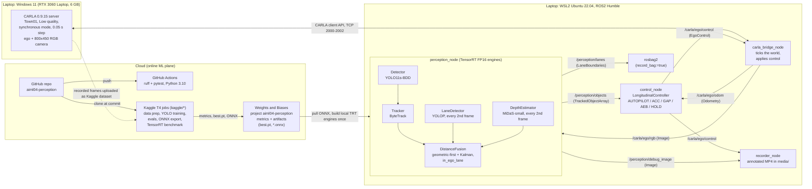
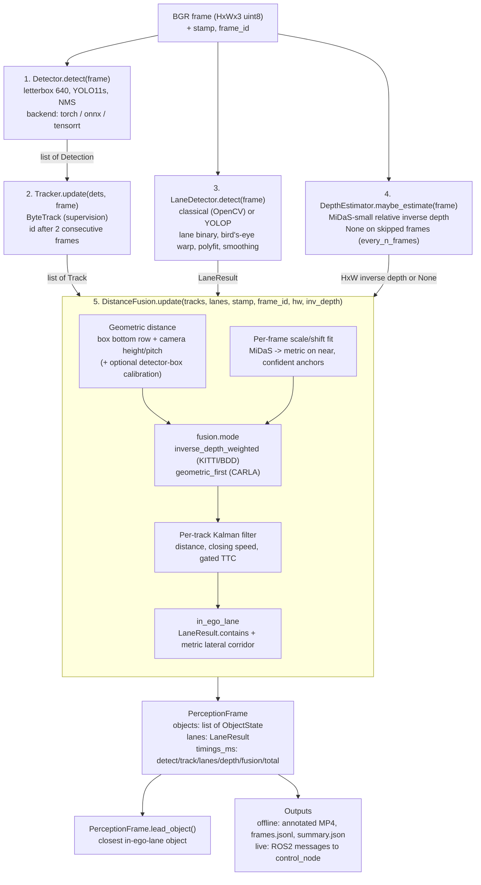

# Diagrams

The Mermaid sources are the `.mmd` files in this folder. GitHub renders the copies below directly,
so you can read them on the repo page without an image export. A PNG/SVG export for the slides and
the Drive folder is still open (see "Exporting" below).

| File | What it shows | Based on |
|---|---|---|
| `architecture.mmd` | Cloud plane (GitHub, Actions, Kaggle, W&B) and the laptop runtime (CARLA on Windows, ROS2 nodes in WSL2) with topics | ARCHITECTURE.md section 2, `ros2_ws/src/perception_ros` |
| `pipeline.mmd` | Stages of `perception.pipeline.Pipeline.process` and the types passed between them | `perception/pipeline.py`, `perception/types.py` |

If you change a `.mmd` file, copy it into the matching block below.

## System architecture

Solid arrows inside WSL2 are ROS2 topics. Not drawn: `/carla/ego/depth_gt`, which the bridge
publishes only when `depth_camera.enabled` is true in `configs/carla.yaml` (off by default; nothing
live reads it). The dashed arrow is the offline path used for the M5.6 sim eval. Full topic and
message reference: [docs/API.md](../API.md).

## Perception pipeline data flow

Stages 1 to 4 each read the raw frame; only the tracker depends on the detector. Fusion is the one
place where they meet. `timings_ms` records the wall time of each call, so frames where YOLOP or
MiDaS is skipped show a small amortised cost.

## Exporting PNG/SVG (TODO for slides and Drive)
Rendering locally needs `@mermaid-js/mermaid-cli`, which downloads a headless Chromium. That is too
heavy for the laptop, so the export was not done. To export without installing anything:
1. Open this page on GitHub, or paste a `.mmd` file into the Mermaid Live Editor in a browser.
2. Export PNG (for slides) and SVG (for print), and save them as `docs/diagrams/architecture.png`
   and `docs/diagrams/pipeline.png`.
